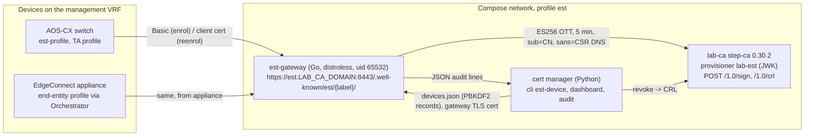
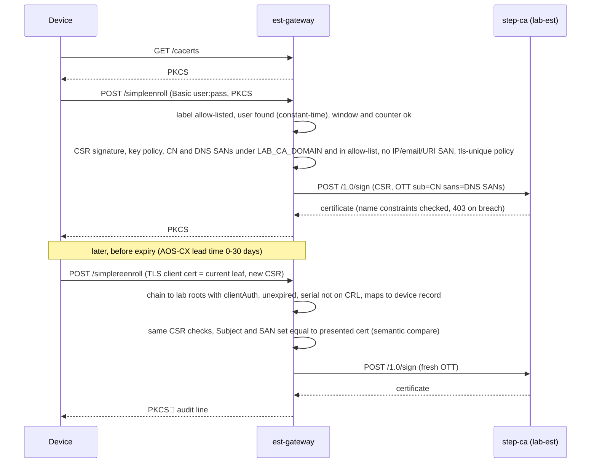

# Roadmap

State of the platform after 1.3, what the research round changed, and the plan for phase 2.
Written for the repository owner and contributors.

**The key insight.** step-ca has no EST in any released version (0.30.2 is current; EST exists
only as two unmerged pull requests, one self-described as incomplete), so the EST phase is a
gateway in front of a dedicated `lab-est` JWK provisioner, not a provisioner flag. The one
reusable building block is the MIT `globalsign/est` Go library, and two of its checks reject
every re-enrolment as shipped: it compares the CSR subject to the client certificate byte for
byte (step-ca re-encodes a UTF8String CN as PrintableString), and it requires `clientAuth` on
the presented certificate (the lab leaf template is `serverAuth` only). Both were reproduced
end to end. Everything else in phase 2 is blocked on hardware captures, not on code: the HPE
doc sites (AOS-CX, EdgeConnect, ClearPass, Orchestrator) returned HTTP 403 to every automated
fetch, so wire-level device behaviour is known only from search excerpts and walkthroughs.

Evidence labels: **V** read from a primary source (RFC, source code, release asset, live
endpoint, or reproduced locally); **I** inference from such sources; **E** rests on
search-engine excerpts of a vendor page that could not be read, or on a summarised fetch.
Treat **E** as a hypothesis to confirm on hardware.

## 1. Where 1.3 leaves the platform

Everything below is on the 1.3 branch; the GitHub issues stay open until it merges.

| Issue | Title | 1.3 status |
|---|---|---|
| #5 bug | Per-server run lock | Done. `fcntl.flock` per certificate under `/config/locks`, shared by cron, UI and CLI (CLI exits 3 with holder pid, start, actor). |
| #6 bug | CSRF, login rate limiting | Done. Token tied to the `csrf` cookie on every non-GET route; `SameSite=Strict`; 5 failures per user and address lock for 15 min. |
| #7 | Non-root container | Done. uid/gid 10001 by default, `OACM_UID`/`OACM_GID` from `.env`, preflight names the chown fix. |
| #8 | Rollback must not cross environments | Done. Snapshots record the CA environment; `allow_cross_env_rollback` per target, off by default. |
| #9 | Renewal window as lifetime fraction, ARI | Done. Renew when 1/3 of the lifetime remains (1/2 at 10 days or less); ARI (RFC 9773) consulted first on scheduled runs; a rejected `replaces` is retried once without ARI. |
| #10 | Versioned GHCR image | Done on the branch. `release.yml` on `v*`: `scripts/check-version.py`, full CI, multi-arch build, SBOM + provenance, signed attestation, Release from the CHANGELOG, no `:latest`. First publish needs owner actions (section 5). |
| #11 bug | Healthcheck covers the scheduler | Done. `/healthz` 503 when no pass finished within twice the cron interval; entrypoint exits if either process dies. |
| #12 | Generic Lego DNS passthrough | Done. `dns.env` per certificate, redacted, allow-listed subprocess environment; any Lego provider's variables go through it, including the `_FILE` form. The README lists the common providers; the UI has no per-provider form. |
| #13 | Backup / restore | Done. `cli backup\|restore`, `setup.sh --backup\|--restore`, optional AES-256-GCM, newer `servers.json` refused without `--force`. |
| #14 | Actor and source in history | Done. `scheduler · cron`, `alice · web`, `root · cli` on every run, in history, API and alerts. |
| #15 bug | Staging round-trip hardening | Done. Last non-empty stderr line, `service` wrapper and missing `sudo`/`--no-block` flagged, TLS failures their own kind and never retried. |
| #16 epic | Pluggable deploy targets | Core done: `servers.json` v2 (certificates with targets, pre-1.3 files migrated on save), driver contract `preflight / probe / deploy / activate / verify / snapshot / rollback`, registry in `app/drivers/`. Closes when #20 and #21 are confirmed on hardware. |
| #19 | Orchestrator driver | Done, behaviour unchanged (REST validate/install, SSH restart + nginx reload, served serial on :443, rollback). |
| #20 | ClearPass driver | Implemented: OAuth2 client credentials, node list, PKCS#12 from a short-lived callback listener, subscribers first and entry node last, per-node API and :443 verification, dual HTTPS slot policy (`block`/`warn`/`ignore`), rollback of nodes changed in the run. **Not yet run against a cluster.** Trust list not automated. |
| #21 | EdgeConnect appliance via Orchestrator | Read-only parts real (version, appliance state, reachability, reported certificate, Test API). Write path behind `experimental_passthrough_write` with a configurable process to restart; monitor-only until confirmed on a lab appliance. |
| #22 | Generic SSH/SCP driver | Done. SFTP upload with atomic rename, key mode 600, optional full-chain file, activation command, `sudo -n -l` probe, served serial on host:port. |
| #17 epic, #23, #24, #25 | EST gateway, provisioner and records, AOS-CX and EdgeConnect acceptance | Open. Phase 2, section 3. |
| #26 | Operational surface in the web UI | Delivered by the System page (1.2) and its 1.3 additions (scheduler state, active runs, lab CA probe, root download, ⓘ indicators). Re-check the acceptance list before closing. |

Also in 1.3, not tied to an issue: pins moved to current releases (Flask 3.1.3, requests 2.34.2,
paramiko 5.0.1, cryptography 50.0.2, certifi 2026.10.19, pytest 9.1.1, ruff 0.17.1; wheels only),
supercronic 0.2.51 with hand-computed checksums, Lego 5.5.2, base image by digest, actions by
commit SHA with Dependabot, `MAX_CONTENT_LENGTH` set. The Flask development server still serves
the UI; a WSGI server is a phase 2 item.

## 2. What the research changed

### step-ca and EST

- **V** step-ca 0.30.2 (March 2026) is current; docs, README, CHANGELOG and `step ca provisioner
  add --type` know no EST. PR #2762 is a maintainer draft ("a non-complete EST implementation",
  active 2026-10-12); PR #2507 sits on the undated v0.31.0 milestone as "not yet usable". PR
  metadata came through summarised fetches (**E**); the absence in the shipped CLI is verified.
- **V** Name constraints are enforced at issuance and renewal (HTTP 403); the CN is **not**
  checked and an empty-SAN CSR is accepted (`claims.SANs` becomes `[subject]`, jwk.go 168-170),
  so the gateway must authorise CN and SANs itself. Templates are per provisioner (`pki/leaf.tpl`
  is serverAuth only); authority policy is global, skipped on renewal, and moves to the admin DB
  under remote management: no per-provisioner policy.
- **V** SCEP works in 0.30.2 but authenticates renewals by challenge only, needs plain HTTP, and
  the docs require an RSA intermediate (the lab chain is EC). EST-to-SCEP bridging breaks on
  tls-unique (#2796 declined). No device in scope lacks EST, so SCEP is not planned.
- **V** libest is unmaintained (2020); EJBCA, Dogtag, OpenXPKI, xipki are CAs, not gateways;
  `globalsign/est` v1.0.7 (MIT, Nov 2025, commits to Sep 2026) is the one reusable library. Its
  README calls its server a test/dev tool; no image is shipped.

### EST gateway implementation (all reproduced; step-ca simulated with `go.step.sm/crypto`)

1. **V** `/simplereenroll` compares `csr.RawSubject` to the client certificate byte for byte;
   step-ca's re-encoding (UTF8String to PrintableString) makes it 403.
2. **V** The presented leaf is verified with `ExtKeyUsageClientAuth` only. The EST template needs
   `clientAuth` and must take DNS SANs from `.Insecure.CR`, or a token-derived SAN breaks the
   SAN-equality check for SAN-less CSRs.
3. **V** Go's `tls.RequestClientCert` completes the handshake with an unknown or expired client
   certificate and lets the application decide; Python's `ssl` (`CERT_OPTIONAL`) aborts with
   alert 48 before any HTTP authentication.
4. **V** `CheckBasicAuth` also gates `/simplereenroll` and `/healthcheck`; `middleware.RealIP` is
   unconditional, so the logged address is client-forgeable.
5. **V** tls-unique is never verified (RFC 7030 3.5: MUST when present). `/csrattrs` can return a
   literal 204 or 404 through an `est.Error`.

### AOS-CX

- **V** (REST reference v10.18, hardening guide mirror, RFC 7030, two walkthroughs):
  `reenrollment_lead_time` 0-30 days (default 2), `retry_count` 0-32, `retry_interval` 30-600 s,
  label ≤ 64 chars, URL ≤ 192 chars, EST VRF defaults to `mgmt`; keys RSA 2048/3072/4096, ECDSA
  P-256/384/521; SAN ≤ 2 DNS + 2 IP; no SCEP or ACME anywhere in the REST index; OCSP for peers
  only, nothing checks the switch's own certificate; TLS 1.2 minimum, 1.3 allowed by v10.18.
  Binding is two commands, `crypto pki application https-server certificate <name>` and
  `https-server vrf <vrf>`; the `https-server certificate <name> vrf` form in the epic does not exist.
- **E** CSR SAN only from 10.15; deleting an EST profile removes its TA profiles and enrolled
  certificates; expiry falls back silently to the self-signed `local-cert`. Unknown until
  captured: Basic vs Digest, `/csrattrs` use, CSR string types, client certificate on
  re-enrolment, behaviour when the gateway rejects the leaf (**I** falls back to password enrol).

### EdgeConnect and Orchestrator

- **V** (HPE Postman collections 9.3-9.6, developer hub, pyedgeconnect): Orchestrator holds EST
  server profiles (`/gms/rest/security/estServer`) and end-entity profiles; the appliance is the
  EST client; Orchestrator's own certificate stays on `POST /gms/rest/gms/httpsCertificate` with
  the body this tool sends; `GET /gms/rest/httpsCertificate?nePk=` and
  `/appliance/rest?nePk=&url=httpsCertificate/config` read what an appliance serves; 9.3.0 moved
  path parameters to query parameters; pyedgeconnect has no certificate or EST functions.
- **E** EST orchestration since 9.4.3; direct appliance uploads are overwritten by sync; the
  appliance install endpoint needs a manual nodejs restart; 9.5.8 upgrades reset a custom
  certificate. No public API collection above 9.6.
- **V** (Common Criteria Security Target, 9.7 OpenAPI copy): recent on-prem builds run Rocky
  Linux, `gms.service` under systemd, nginx terminates TLS, no API restarts GMS or nginx, the SSH
  server accepts only rsa-sha2-256/512 and ecdsa-nistp256/384/521 (explains the Ed25519 failure).

### ClearPass

- **V** (developer hub 6.11.0, 6.12.0, 6.14.1; sibling tool): the only install path is
  `PUT /api/server-cert/name/{server_uuid}/{service_name}` with `pkcs12_file_url` +
  `pkcs12_passphrase`; no inline upload. 6.10 added HTTPS(RSA)/HTTPS(ECC); ECC rejects RSA keys;
  both enabled is fine, both disabled is not. 6.14.0 removed SHA-1 certificates (6.14.1 restored
  SHA-1 roots). There is no 6.13.
- **E** The PUT restarts the affected service; writes to any node are proxied to the publisher.
  Whether a subscriber-UUID PUT sent to the publisher lands on that subscriber is undocumented.

### Let's Encrypt, ARI and Lego

- **V** (profiles page, a live production certificate, Boulder source, live renewalInfo, Lego
  v5.5.2): the schedule in section 5; ARI window centred at two thirds of the lifetime, 2 % wide,
  Retry-After about 6 h; a `replaces` naming another account's or CA's certificate is fatal in
  Lego (only 409 alreadyReplaced is retried); OCSP gone since 2025-08-06, CRL only; Lego v5
  writes PKCS#8 keys and an empty CN unless `--enable-cn`; no flag the repo passes was removed
  between 5.3.1 and 5.5.2. go-acme/lego pages came through summarised fetches (quotes paraphrased).

### Release and dependencies

- **V** Every runtime pin 1.3 replaced carried an OSV advisory (Flask 3.0.3, requests 2.32.3,
  paramiko 3.4.1, cryptography 43.0.1 with six advisories including the bundled-OpenSSL one,
  certifi 2026.10.18 missing three unaffected emSign roots). The new set resolves to 25 packages
  with zero advisories; the suite passes unchanged on 3.12 and 3.13; all have aarch64 wheels.
- **V** paramiko 5 removes SHA-1. Against real sshd: ed25519, ECDSA and RSA (rsa-sha2) pass; a
  server offering only an ssh-rsa host key, only DH-SHA1 kex or only SHA-1 RSA user signatures
  fails. `sshcheck` explains the first two and names SHA-1-only servers as a possible cause of the third.
  5.1.0 adds the ML-KEM hybrid kex (verified against OpenSSH 10.0p2); 1.3 ships 5.0.1. The
  release workflow has not yet run on a real runner.

## 3. Phase 2: EST gateway (#17, #23, #24, #25)

### Architecture

Mounts, all read-only except `data/est/state` (enrolment counters): `data/pki/certs:/pki`
(never the whole PKI), `data/est/secrets` (the provisioner JWK, present nowhere else),
`data/est/config` (`devices.json`, written by the Python CLI, reloaded on mtime), `data/est/tls`
(the gateway's own leaf for `est.<LAB_CA_DOMAIN>`, issued by the cert manager through the SSH/file
driver, reloaded on mtime). `read_only`, `cap_drop: [ALL]`, `no-new-privileges`. The gateway
reaches the CA by the `LAB_CA_HOST` alias (the CA certificate has no IP SAN) and pins the root.

### Chosen implementation and why

**Go wire layer on vendored `globalsign/est` v1.0.7; Python keeps credentials, CLI and UI.**
Findings 3 and 5 decide it: Python's `ssl` cannot accept an unknown or expired client
certificate and defer to policy (a device whose leaf lapsed would never reach the Basic
fallback), and only Go exposes `r.TLS.TLSUnique`. A pure-Python gateway interoperates with the
reference client (the prototype proved it) but needs a TLS-terminating proxy and forfeits
tls-unique; it wins only if captures show devices never present unverifiable certificates and
never send `challengePassword`. Cost of Go: a second language, a vendored library with a
documented patch, Go CI; the image is about 5 MiB static. The step-ca client is about 120 lines
of `net/http` + go-jose, not `smallstep/certificates/ca` (+20 MiB, 700 packages).

Library changes, all small: semantic subject compare on `/simplereenroll` (RDN canonicalisation;
chain check kept), TCP peer from `http.Server.ConnContext` instead of `RealIP`, a Basic-auth
callback that returns nil on the reenrol path when a client certificate is present, tls-unique
verify-if-present, `go.mozilla.org/pkcs7` bumped to v0.10.0, `/serverkeygen`, `/tpmenroll` and
`/fullcmc` left at 501/404 so no PKCS#7 parser is reachable from the network.

### step-ca changes (`pki/lab-est-init.sh`, run by `setup.sh --with-est`)

| Item | Setting | Reason |
|---|---|---|
| Provisioner | `lab-est`, JWK, added with `--public-key` only; EC P-256 key generated into `data/est/secrets/` mode 0400 | The JWK is a signing capability for the lab CA; never reuse `lab-admin` (its password is the intermediate key's). |
| Template | `pki/est-leaf.tpl`: `subject` and `dnsNames` from `.Insecure.CR`, KU by key type as in `leaf.tpl`, `extKeyUsage: [clientAuth, serverAuth]` (drop `serverAuth` if devices never serve), CRL DP substituted like `leaf.tpl`, no IP/email/URI SANs | `clientAuth` for the reenrol check; CSR SANs preserved so renewal CSRs match; the ACME `lab` provisioner stays serverAuth only (#17). |
| Claims | `--x509-min-dur 24h`, `--x509-max-dur` / `--x509-default-dur` per device policy (lab default 2160h), `--disable-renewal` | Lifetime bounded by the CA; re-issue only through the gateway's authorisation. |
| Name constraints | Unchanged: permitted `.LAB_CA_DOMAIN`, all IP ranges excluded, email and URI unconstrained (**I**) | The gateway rejects IP, email and URI SANs before signing; changing constraints needs the offline root. |
| Token | ES256 with `kid`; `aud https://LAB_CA_HOST:PORT/1.0/sign`, `sub` = CN, `sans` = exactly the CSR's DNS SANs, 256-bit `jti`, `exp` +5 min | Issuance is what the gateway authorised, never what the CSR asked for. |
| Error mapping | CA 403 with a constraint/SAN message → EST 403 plain-text reason; CA 401 or connection failure → EST 503 + Retry-After | AOS-CX shows little; a gateway fault must not look like a device fault. |

The script must be idempotent on an initialised CA and never touch the root, intermediate,
`lab-admin` or `secrets/password`. The exact `step` flags have not been executed yet; confirm with CLI 0.31.0 from `ci.yml`
before the script is written.

### Enrol and re-enrol flow

### Device matrix

| | AOS-CX | EdgeConnect appliance | ClearPass |
|---|---|---|---|
| Role toward the gateway | EST client, profile on the switch (**V**) | EST client driven by an Orchestrator end-entity profile, 9.4.3+ (**E**) | Not a client. ClearPass is itself an EST server that cannot issue server certificates; it stays a REST deploy target (#20). |
| Initial authentication | username + password in the profile; Basic vs Digest unknown (**E**) | host/port/username/password, optional challenge password, up to three labels (**E**) | n/a |
| Re-enrolment | current leaf as TLS client cert; lead time 0-30 days, retries 0-32 × 30-600 s (**V**) | `reenrollment_threshold_perc`, semantics unknown (**E**) | n/a |
| CSR shape | subject + key type on the switch; SAN (2 DNS + 2 IP) from 10.15 (**E**); string types unknown | unknown; RSA 2048 shown (**E**) | n/a |
| Key types | RSA 2048/3072/4096, ECDSA P-256/384/521 (**V**) | unknown | n/a |
| Failure mode | silent fallback to self-signed `local-cert` on expiry (**E**) | `state.failure_description` on the profile (**E**) | n/a |
| Revocation | OCSP for peers only; never checks its own cert (**V**) | unknown | n/a |
| Gateway policy class | `aoscx`: DNS SANs ≤ 2, no IP SANs, tls-unique verify-if-present | `edgeconnect`: from the capture | n/a |

### Security model

- `/simpleenroll` by HTTP Basic against a per-device PBKDF2 record (the web UI's scheme);
  `/simplereenroll` by a lab-issued client certificate. Default credential: per-device standing
  credential with a validity window, a maximum enrolment count and an explicit `re-arm`. Strict
  single-use OTPs (#17, #23 wording) fit the schema but are not the default: AOS-CX stores one
  fixed username and password and falls back silently to self-signed after expiry, so a spent
  OTP strands a switch.
- Authorisation order: label → user → window/counter → CSR signature and key policy → CN under
  `LAB_CA_DOMAIN` and in `allowed_cn` → DNS SANs ⊆ `allowed_dns_sans`, count ≤ `max_dns_sans`,
  no IP/email/URI SAN → tls-unique policy (`verify-if-present` default, `require`, `ignore` as a
  documented deviation; TLS 1.3 has no tls-unique) → token → sign. Reenrol adds chain, expiry,
  CRL and subject/SAN equality.
- Listener: TLS 1.2+, ECDHE + AES-GCM, `RequestClientCert` with nil `ClientCAs`, `GetCertificate`
  reloading on mtime, a DNS-SAN certificate under the lab domain (so the device URL must be an
  FQDN resolvable from the management VRF and the lab root must be in the TA profile). Per-IP
  and per-username failure budgets (the library's `RateLimit` is one global bucket). `/healthz`
  on a loopback-only plain listener, because the library's `/healthcheck` needs Basic credentials.
- Audit (JSON lines): request id, event, outcome, TCP peer, TLS version and cipher, label, auth
  method, username/device id, client cert serial and fingerprint, CSR hash/CN/SANs/key/signature
  algorithm, tls-unique presence and result, step-ca status class, issued serial and notAfter,
  token `jti`, latency, deny reason. Never passwords, tokens, private keys or CSR PEM.

### Acceptance tests

- Table tests: UTF8String-subject CSR reenrols; serverAuth-only leaf refused for reenrol;
  SAN-less CSR enrols and reenrols with identical SAN bytes; IP SAN rejected by the gateway, not
  by a step-ca 403; constraint 403 → EST 403 with reason; CA down → 503 + Retry-After; tls-unique
  mismatch rejected; expired client cert reaches the Basic path; disabled device refused.
- CI: `est-interop` (`globalsign/estclient` at the pinned tag runs cacerts/enrol/reenrol against
  the gateway with a fake step-ca), `est-go` (vet, test, `CGO_ENABLED=0`, govulncheck),
  `est-image` (uid 65532, read-only root), and `lab-ca-smoke` extended with `lab-est-init.sh`
  against the real step-ca image plus one enrol and one reenrol.
- Hardware (#24, #25): lab root installed, enrol with a device credential, served certificate
  replaced and chaining cleanly, automatic re-enrolment, revocation where the device checks it,
  exact device configuration recorded in the README.

### What needs hardware before the design is final

The AOS-CX and EdgeConnect captures (section 6), AOS-CX behaviour when the gateway rejects the
presented leaf, EdgeConnect's handling of 202 Retry-After, AOS-CX password limits, and whether
the profile label is appended to the path. None of these block building and testing the core
gateway against the reference client; they set per-class policy defaults and the credential flow.

## 4. Phase 2: device drivers still open

### EdgeConnect write path (#21)

Everything known is read-side. The supported writes are the HTTPS Certificate template (schema
not public) and EST end-entity profiles (overlaps #25). Captures from an Orchestrator 9.4.3+,
secrets redacted: (1) `GET /gms/rest/httpsCertificate?nePk=<NE>`, repeated after a certificate
change (live or cached?), and `GET /gms/rest/appliance/rest?nePk=<NE>&url=httpsCertificate/config`;
(2) a Custom Certificate saved once in Templates → HTTPS Certificate with dev tools open, or
`GET /gms/rest/template/templateGroups?templateGroup=<g>`: template name, `valObject`, whether
saving applies immediately or needs Apply Template Groups; (3) on a spare appliance, whether
`POST /appliance/rest?nePk=&url=httpsCertificate/config` survives a sync, which
`cnprocess/restart/<name>` is valid, whether the UI is interrupted; (4) `gmsApiInfo.json`
(Support → REST APIs) for `security/endEntityProfiles` and `security/estServer`: enum strings
for purpose and `csr_attrs`, the meaning of `reenrollment_threshold_perc`, any restart/reload
endpoint for `gms/httpsCertificate`; (5) `GET /rbac/allowedRestApis?method=POST`: does
`net_read_write` cover `security/*`, `template/templateGroups` and the passthrough. Until then
the driver stays monitor-only; preflight gates on `GET /gms/versions` (≥ 9.3 query-parameter
endpoints, ≥ 9.4.3 EST profiles, warn on 9.7.x/10.x).

### AOS-CX: push versus pull

AOS-CX has no ACME or SCEP client (**V**): ACME certificates can only be pushed; lab-CA
certificates can be pushed or pulled over EST. Push is a fourth driver:
`PUT /rest/v10.xx/certificates/{name}` (or SSH `import terminal`), then `crypto pki application
https-server certificate <name>`, `https-server vrf <vrf>`, save, served serial on :443. Pull is
section 3 plus a profile push. Let the contract express both and decide per switch. Captures
from one switch: `crypto pki est-profile X ?` and the sub-commands under `crypto pki certificate
Y`, `show running-config` after setup, `crypto pki ?` (no scep/acme), `show https-server` (REST
access mode), whether binding and an automatic re-enrolment take effect without a restart, and
the VRF used for EST and HTTPS.

### ClearPass hardware validation (#20)

The driver is complete against the documented schema; six behaviours rest on third parties or
the sibling tool. From the live cluster: (1) does `PUT /api/server-cert/name/{subscriber_uuid}/HTTPS(RSA)`
sent to the publisher land on that subscriber, and which node's IP fetches `pkcs12_file_url`
(decides `single` vs `per_node` entry and the callback allow-list); (2) shape of
`GET /api/server-cert` (HAL `_embedded.items`, list, single object) and whether it is node-local;
(3) PUT duration, whether the connection you talk through drops, time until :443 serves the new
certificate per node; (4) acceptance of an `http://` callback, an OpenSSL 3 PKCS#12
(PBES2/AES-256, SHA-256 MAC) and the generated passphrase on your release, FIPS mode; (5) the
403 → privilege mapping for the operator profile; (6) whether RADIUS/RadSec changes may run
unattended.

### Orchestrator driver refinements (#19 follow-ups)

On 9.6/9.7: validation + install, then poll `openssl s_client` 60-120 s with no SSH, then
`systemctl reload nginx` only, then GMS restart only; decides whether SSH becomes optional and
whether the GMS restart is needed at all. From the lab appliance: `cat /etc/os-release; uname -r;
systemctl cat gms.service nginx.service; sudo -l; ss -ltnp | grep ':443'` and
`GET /gmsserver/info`. Add a served-serial drift check on every scheduled run (the 9.5.8 reset is
**E**) with an automatic Force deploy on drift.

## 5. Operations

### Let's Encrypt lifetime timeline

| Date | Change (**V**) | Authorization reuse |
|---|---|---|
| 2026-01-15 | `shortlived` profile GA: 160 h, the only profile with IP addresses | 7 h |
| 2026-03-15 | CA/B BR 2.3.1 cap 200 days | 200 days |
| 2026-05-13 | `tlsserver` profile: 45 days, no CN, no key encipherment | 7 h |
| 2026-10-14 | Staging classic issues 64 days | 10 days |
| 2027-02-10 | **Production classic 64 days** (last 90-day certificate expires about 2027-05-11) | 10 days |
| 2027-03-15 | CA/B BR cap 100 days | 100 days |
| 2028-02-16 | **Production classic 45 days** | 7 h |
| 2029-03-15 | CA/B BR cap 47 days | 10 days |

What the 1.3 window does at each step with no configuration change: renew when a third of the
lifetime remains, computed from `notBefore`/`notAfter` (30 of 90, about 21 of 64, 15 of 45),
half at 10 days or less (about 3.3 of 6.7), with ARI checked first on scheduled runs so an
incident-driven "renew now" (the May 2026 Gen Y cross-sign incident produced 688,413 of them) is
honoured within one cron interval. `RENEW_WINDOW_DAYS` is an absolute override that should stay
unset. The 02:00/14:00 cron meets the twice-a-day guidance for 45-90 day certificates; a
`shortlived` certificate (ARI window about 3 h) would need a per-certificate cadence the fixed
schedule does not offer. The operational consequence of the dates is validation, not the
window: from 2027-02-10 authorizations are reused for 10 days, from 2028-02-16 for 7 hours, so
every renewal performs a fresh DNS-01 solve. `DNS_PROPAGATION_WAIT` (60 s fixed; the provider's
own propagation checks are inert while the flag is passed) and the Cloudflare token become the
dominant failure source. Alert on the first failed attempt.

### ARI and rate limits

- ARI GET is unauthenticated, keyed by `base64url(AKI)`.`base64url(serial)`; Boulder answers
  Retry-After about 6 h ± 20 %. `replaces` is accepted only for the same account at the same CA;
  1.3 retries once without ARI on rejection and disables ARI when the certificate on disk came
  from another environment. An account or e-mail change has the same effect, so the account
  directory stays in backups (it does).
- Limits (docs 2026-08-05): 300 new orders per account per 3 h; 50 certificates per registered
  domain per 7 days; 5 duplicates per exact identifier set per 7 days (refill 1 per 34 h, no
  override); 5 authorization failures per identifier per hour; pause after 1,152 consecutive
  failures. ARI in-window renewals are exempt from all; a Force renew is not, so the UI should
  warn before a second one inside 7 days (not implemented).
- Never request Must-Staple; production certificates carry a CRL DP only, so a consumer that
  insists on an OCSP responder fails. A `--profile` change forces a renewal that is not
  ARI-exempt; plan it once per certificate if adopted.

### Dependency and release policy

| Component | 1.3 | Policy |
|---|---|---|
| Runtime deps | Flask 3.1.3, requests 2.34.2, paramiko 5.0.1, cryptography 50.0.2, certifi 2026.10.19 | Exact pins, wheels only, OSV clean at release; Dependabot weekly, grouped. certifi feeds `api_trust_bundle()`, so it is a security pin. |
| Dev deps | pytest 9.1.1, ruff 0.17.1 | `ruff check` only; `ruff format` would touch 38 files and is not in CI. |
| Base image | `python:3.12-slim` by digest (Debian trixie 13.7) | Dependabot bumps the digest. 3.12 supported to 2028-10; 3.13 is a separate optional commit (digest, `ci.yml`, ruff target). |
| Lego | 5.5.2, checksum file, per-`TARGETARCH` asset | `ARG` pin, invisible to Dependabot: manual watch. |
| supercronic | 0.2.51, SHA-256 computed from the binaries (upstream publishes SHA-1 only) | `ARG` pin, manual; recompute both hashes together. |
| step-ca / step CLI | 0.30.2 image (compose, Dependabot) / 0.31.0 CLI (`ci.yml` env, manual) | CA/CLI skew is normal. |
| Actions | checkout 7.0.1, setup-python 7.1.0, setup-qemu 4.4.0, setup-buildx 4.4.1, login 4.6.0, metadata 6.2.0, build-push 7.4.0, attest 4.2.2 | SHA-pinned with a version comment; Dependabot keeps both. |
| SSH compatibility | paramiko 5: no SHA-1 (ssh-rsa host-key signatures, DH-SHA1, DSS) | In UPGRADING.md; the tool does not re-enable SHA-1. Orchestrator (OpenSSH 7.4+) is unaffected. |

Release: a `vX.Y.Z` tag on `main` with `__version__`, the compose tag and the dated CHANGELOG
heading in agreement; tags `:X.Y.Z` and `:X.Y`, never `:latest`; operators deploy tags, not
`main`. Owner actions for the first publish: confirm nothing was ever pushed by hand to the GHCR
package (an unlinked package blocks `GITHUB_TOKEN`), cut `v1.3.0-rc.1` to exercise push,
attestation and the ancestry check, flip the package to Public once (irreversible), verify an
anonymous `docker pull` and `gh attestation verify`, then tag `v1.3.0`. Phase 2 hygiene: a
hash-locked universal `requirements.lock` (ready in the research scratch; one more pip call in
CI); a real-sshd integration test (ed25519, ECDSA, RSA, one SFTP write/rename) because the suite
mocks paramiko; a production WSGI server instead of `app.run()`.

## 6. Questions for the owner

Merged and de-duplicated from all ten research results; one line each, then why.

### Critical path (answered before Phase 2 starts)

1. May the wire-facing EST component be a static Go binary (vendored, patched `globalsign/est`)
   with credentials, CLI and UI in Python? Decides the build; pure Python needs a
   TLS-terminating sidecar and cannot verify tls-unique.
2. Device inventory: AOS-CX models and `show version`, Orchestrator build and ECOS versions,
   ClearPass versions and topology. Sets every version gate (10.15 SANs, 9.4.3 EST profiles, 6.10
   HTTPS slots) and the supported matrix.
3. One AOS-CX EST enrol-then-reenrol capture: CSR DER (RDN string types, SANs, key, signature,
   challengePassword), request line and headers, Authorization timing, TLS version and ciphers,
   `/csrattrs` use, client cert on first enrol, chain on reenrol. Settles the UTF8String trap,
   SAN-less CSRs, the expired-leaf path and the tls-unique default.
4. The same capture from an EdgeConnect appliance on 9.4.3+, plus the `estServer` and end-entity
   profile JSON. EdgeConnect's wire behaviour is otherwise undocumented.
5. What the device certificates are for (switch HTTPS, RadSec, 802.1X, IPsec), the lifetime (lab
   default 90 days), any need for IP SANs. Sets EKU, `lab-est` claims, and whether the
   intermediate's constraints must be rebuilt with the offline root.
6. Gateway name and port (suggest `est.<LAB_CA_DOMAIN>:8443`), resolvable and reachable from the
   switches' management VRF and the appliances? Name-constrained, DNS-only certificates cannot
   validate a bare-IP URL.
7. Credential model: standing per-device credential with window and counter (proposed default)
   or strict single-use OTPs? AOS-CX keeps one fixed credential and falls back silently to
   self-signed on expiry.
8. ClearPass: can every node open an inbound TCP connection to the container host on a fixed
   callback port over plain HTTP? The API only imports from a URL.
9. ClearPass identity: one certificate (cluster FQDN + node FQDNs) on all nodes or one per node;
   which slots? ECC slots need a second EC issuance.
10. Can every target consume PKCS#8 keys, no CN and no OCSP URL? Lego v5 and Let's Encrypt
    changed all three; otherwise `issue.py` needs `--enable-cn` and a re-encode step.
11. Does any SSH target run OpenSSH older than 7.2 or offer only SHA-1 algorithms? paramiko 5
    (in 1.3) cannot connect; the alternative is 3.5.1 with an unfixable LOW advisory. Confirm
    before the 1.3 release.

### Round 2 (does not block)

1. ClearPass: subscriber-UUID PUT via the publisher, `GET /api/server-cert` shape, PUT timing and
   connection drop, `http://` callback and OpenSSL 3 PKCS#12 and FIPS, privilege names behind
   each 403, maintenance window for RADIUS/RadSec. Sets timeouts, entry model, preflight text.
2. Have you seen the HTTPS(RSA)/HTTPS(ECC) dual-slot interaction bite (a client picking the slot
   that still serves the old or self-signed certificate)? A concrete symptom sharpens the slot guard.
3. EdgeConnect: the five captures in section 4. Decides the write path.
4. Any Orchestrator in Common Criteria mode or hosted (`*.silverpeak.cloud`)? CC mode reportedly
   rejects custom certificates (**E**); SaaS has no documented SSH.
5. Orchestrator: restart-free apply test on 9.6/9.7, OS/unit dump, survival of sudoers and
   `authorized_keys` across `orch-setup -u`, whether Ed25519 rejection is CC/FIPS-conditional,
   read-write API key on every version. Each removes an SSH dependency or a preflight guess.
6. AOS-CX: the CLI dumps in section 4, activation without restart, management VRF, push versus
   pull per switch, revocation needs (OCSP responder from mgmt?), EST password limits and
   label-to-path behaviour.
7. Should reenrol check the CRL and refuse a disabled device at once? Otherwise a revoked device
   renews until expiry.
8. Manual approval (202 + Retry-After, pending queue in the UI) in the first gateway release, or
   after a device is seen honouring the retry?
9. step-ca remote management acceptable? Needed only for SCEP webhooks or `step ca policy`; it
   ends `ca.json` edits. If SCEP is ever needed: RSA intermediate (new identity) or an RSA RA
   with the EC chain (**I**, untested).
10. Certificate profile per certificate (classic, `tlsserver`, `shortlived`), tolerance for
    activation every 15 or 3 days, blackout windows, one ACME account per environment or per
    certificate. Sets cadence and the `replaces` failure surface.
11. IP certificates or DNS-PERSIST-01, other CAs with EAB, DNS providers beyond Cloudflare,
    policy for `exec` and `manual`, real propagation checks instead of the fixed wait, any pre-v5
    Lego state never migrated.
12. Release: image public on GHCR, nothing pushed by hand, pre-release dry run allowed,
    auto-published Release notes or a draft.
13. Dependencies: paramiko 5.1.0 (ML-KEM kex) after a soak or stay on 5.0.1; Python 3.13 now or
    later; `requirements.lock` or only `--only-binary`.
14. The HPE techdocs pages (AOS-CX Security Guide 10.13-10.16, Orchestrator user guide and
    9.5.8/9.6.2/9.7.1 release notes, EdgeConnect End Entity and HTTPS Certificate tabs, ClearPass
    Import Server Certificate) as PDFs or text. Every **E** here becomes **V** or is corrected.

## 7. Watch list

| What | Why | Check |
|---|---|---|
| step-ca PR #2762 (draft EST), PR #2507 (v0.31.0 milestone), issue #2366 | If a release ships EST the gateway can retire behind the same `/.well-known/est` URL; template, constraint and policy work carries over. | Each step-ca release. |
| step-ca 0.30.x/0.31.x, step CLI 0.31.x | `crl` block is documented experimental; `STEP_CLI_VERSION` and `STEP_CA_IMAGE` in `ci.yml` are manual pins. | Monthly. |
| Lego 5.5.x → 5.6 / 6 | ARI and `replaces` behaviour (the `_ARI_MARKERS` heuristic in `issue.py` depends on error text), PKCS#8/CN defaults, `--profile` semantics; `LEGO_VERSION` is an `ARG`, invisible to Dependabot. | Each release; re-run the staging round trip. |
| Let's Encrypt 2027-02-10 and 2028-02-16 | 64 then 45 days; authorization reuse 10 days then 7 h. No code change expected; DNS-01 reliability is the risk. | Profiles page quarterly; fallback-window tests exist for 90/64/45/6.67 days. |
| Action majors (checkout 7, setup-python 7, setup-qemu 4, setup-buildx 4, login 4, metadata 6, build-push 7, attest 4) | `attest-build-provenance` v4 is a wrapper; use `actions/attest`. | Each Dependabot PR; keep the version comment with the SHA. |
| paramiko 5.1.x, cryptography 50.x, certifi | ML-KEM kex, OpenSSL 4 in the wheel, exception types; certifi is on the trust path and a one-day pin difference dropped roots in 2026-10. | Each Dependabot group PR; add the real-sshd test first. |
| supercronic, `python:3.12-slim` digest | Hand-computed SHA-256; 3.12 support ends 2028-10. | Quarterly; 3.13 as its own commit when wanted. |
| ClearPass 6.14.x, Orchestrator 9.7 / 10.0 | SHA-1 removal and restore; no public API collection above Orchestrator 9.6. | When a lab node is upgraded; re-run the driver probes. |
| GHCR visibility and attestation | The public flip is one-way; `gh attestation verify` must pass from a clean host. | Once, at `v1.3.0`. |
